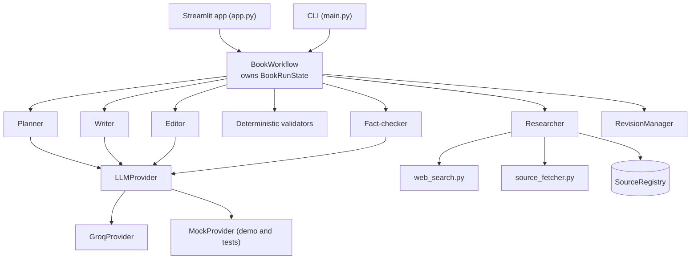

# INK & EVIDENCE — Multi-Agent Book Writer

INK & EVIDENCE plans, researches, writes, edits and fact-checks a short nonfiction
book with five cooperating agents, and refuses to publish a chapter whose citations
do not hold up. Every cited claim must point to a web page the application actually
retrieved.

The default brief is *Pay Me on UPI: How Digital Payments Changed Small Business in
India*: three chapters of 600–900 words for first-time small-business owners, each
ending with a `Takeaway:` line followed by its own numbered reference list.

## Capabilities

- **Five agents:** Planner, Researcher, Writer, Editor and Fact-checker, each with one
  public method.
- **Retrieved evidence only.** Search results are leads, never evidence. Pages are
  fetched (HTML and text-based PDF), honouring `robots.txt`, timeouts and per-domain
  delays; restricted pages (401/403/451, robots exclusions, TLS failures) are recorded
  as inaccessible and never bypassed. Excerpts are verbatim slices of the page text.
- **Citation integrity.** The Writer cites only registered source IDs (`[S03]`). Code
  renders them as chapter-local `[1]`, `[2]` and builds the reference list from the
  source registry, so the model never writes a URL.
- **Deterministic validation** of word count, list formatting, `Takeaway:` placement,
  unknown or unusable sources, reference numbering, URLs in prose, uncited figures
  (numbers, dates, percentages, amounts, circular identifiers, settlement terms) and
  cited figures that do not appear in the cited excerpts.
- **Claim-level fact-checking** with four verdicts, re-checked in code against the
  registry before a verdict counts.
- **Bounded revisions:** at most two per chapter, as minimal edits of the quoted
  problem sentences. Unresolved critical findings block publication.
- **Honest provider handling:** retries are bounded, per-minute rate limits are waited
  out, daily quota exhaustion stops the run with a clear message, and mock output is
  never substituted for a live run.
- **Streamlit app and CLI** with real stage updates, a saved-runs browser, and
  downloadable artifacts.

## Architecture



Per chapter, deterministic checks run first. A draft that is too short or cites an
unknown source is revised without spending model calls on the Editor and Fact-checker.

| Agent | Method | LLM? |
|---|---|---|
| Planner | `create_book_outline(brief)` | Yes |
| Researcher | `collect_chapter_evidence(plan, brief, registry)` | No: search, fetch, keyword-scored verbatim excerpts |
| Writer | `write_chapter(...)` | Yes |
| Editor | `review_chapter(...)` | Yes |
| Fact-checker | `verify_chapter_citations(...)` | Yes, with code-level grounding |

Prompts live in `agents/prompts.py`. Design rationale and the publication policy are in
[docs/DESIGN.md](docs/DESIGN.md).

### Repository layout

```
app.py                 Streamlit app
main.py                Command-line entry point
config.py              Settings from environment variables and .env
agents/                Planner, Researcher, Writer, Editor, Fact-checker, prompts
models/                Pydantic models for briefs, outlines, sources and run state
providers/             LLMProvider interface, Groq and mock implementations
tools/                 Web search, page fetching, citation validation, offline fixtures
workflow/              Orchestration, revision policy, run artifacts
utils/                 Logging with secret redaction
tests/                 Offline test suite
docs/DESIGN.md         Design notes
```

## Prerequisites and installation

Python 3.14 is the version the project was developed on.

```powershell
py -3.14 -m venv .venv
.\.venv\Scripts\Activate.ps1
pip install -r requirements.txt
```

On macOS or Linux: `python3.14 -m venv .venv && source .venv/bin/activate`.

## Configuration

Copy `.env.example` to `.env` and fill in the Groq values. `.env` is git-ignored; never
commit it.

| Variable | Default | Meaning |
|---|---|---|
| `LLM_PROVIDER` | `groq` | `groq` for live runs, `mock` for the offline demo |
| `GROQ_API_KEY` | none | Groq API key |
| `GROQ_MODEL` | none | A Groq model ID that supports JSON mode |
| `LLM_TIMEOUT_SECONDS` | `60` | Per-request timeout |
| `LLM_MAX_RETRIES` | `2` | Retries for transient errors and short rate limits |
| `LLM_MAX_RATE_LIMIT_WAIT_SECONDS` | `65` | Longest single rate-limit wait before stopping |
| `LLM_MAX_COMPLETION_TOKENS` | `3000` | Reply budget, reduced per request so prompt plus reply fit the per-minute limit |
| `LLM_TOKENS_PER_MINUTE_LIMIT` | `8000` | Your Groq tier's per-minute token limit for the model |
| `GROQ_REASONING_EFFORT` | `low` | Sent only to `gpt-oss` models (`low`, `medium`, `high`) |
| `MAX_REVISION_ROUNDS` | `2` | Revisions per chapter (0–2) |
| `MAX_SOURCES_PER_CHAPTER` | `6` | Usable sources sought per chapter |
| `SEARCH_RESULTS_PER_QUERY` | `6` | Results requested per search query |
| `FETCH_TIMEOUT_SECONDS` | `15` | Per-page fetch timeout |
| `PER_DOMAIN_DELAY_SECONDS` | `1.5` | Pause between requests to one site |
| `OUTPUTS_DIR` | `outputs` | Where run directories are created |
| `LOG_LEVEL` | `INFO` | `DEBUG`, `INFO`, `WARNING` or `ERROR` |

Placeholder values copied from `.env.example` are treated as unset. Missing live
settings stop the run before any request is made.

## Running

```powershell
streamlit run app.py                 # web app
python main.py --mock                # offline demo, no key or network needed
python main.py --chapters 1          # one live chapter
python main.py                       # live, three chapters, default brief
python main.py --help
```

CLI exit codes: `0` published, `2` blocked by mandatory checks, `1` failed or misconfigured.

### Live research versus demo mode

- **Live research** uses Groq and real web sources. Results are labelled with the
  number of real sources retrieved and the model used.
- **Offline demo** uses the mock provider and fictional fixture pages on the reserved
  `fixtures.invalid` domain. It exercises every agent without network access, but its
  content is not research: the app shows a "not real research" warning, the book carries
  a banner, and `run_report.json` records `evidence_basis: test_fixtures`.

The application never falls back from live to demo mode on its own.

## Testing

```powershell
python -m pytest -q
```

The suite is offline: it uses fake HTTP sessions, fake search backends, scripted provider
clients and the mock provider, and it makes no API calls. It covers models, configuration,
log redaction, provider errors and quota handling, search ranking, fetching and
extraction, each agent, citation validation and rendering, revision limits, the
publication gate, full mock runs, the Streamlit app (through `streamlit.testing`) and
the CLI.

## Output artifacts

Each run writes to `outputs/run_<UTC timestamp>_<id>/`:

| File | Contents |
|---|---|
| `book.md` | Published runs only: chapters, `Takeaway:` lines, per-chapter numbered references, an evidence-limits note |
| `failure_report.md` | Blocked or failed runs: reasons, unresolved issues, failing claims |
| `drafts/chapterN_revM.md` | Every draft, including rejected ones, with its validation findings |
| `sources.json` | Every source tried: status, failure reason, content hash, excerpts with offsets |
| `run_report.json` | Provider, model, evidence basis, per-chapter results, claim verdicts, source counts |
| `run.log` | Structured `key=value` events with secrets redacted |

The Streamlit sidebar lists saved runs and offers these files for download. Earlier runs
are never overwritten.

## Publication policy

Critical findings (word count out of range, list formatting, missing or misplaced
`Takeaway:`, unknown or unusable citations, uncited figures, cited percentages that are
absent from the cited excerpts, `unsupported` or `contradicted` claims) trigger a
revision and block publication if still unresolved after the revision limit. `uncertain`
claims and some heuristic findings publish as "passed with warnings" and are listed for
human review. See [docs/DESIGN.md](docs/DESIGN.md) for the full table.

## Limitations

- **Automated checks are not proof.** The Fact-checker is a language model and can
  misjudge paraphrases. The uncited-figure check is a heuristic: it flags digits and
  common figure patterns but misses numbers written as words. Review flagged claims and
  spot-check sources against the cited pages before relying on them.
- **Search** uses the free `ddgs` package, which scrapes public result pages and can be
  rate-limited or break. It sits behind a small adapter so it can be replaced.
- **Access restrictions.** Government and regulator sites often block automated clients
  (NPCI's `robots.txt`, for example, excludes unknown crawlers; some sites return 403).
  Those pages are skipped, so official sources may be underrepresented. Each reference
  is labelled official (government, RBI, NPCI hosts) or secondary.
- **Content types.** HTML and text-based PDFs are parsed; scanned PDFs and
  script-rendered pages usually yield too little text and are recorded as inaccessible.
- **Publication dates** are read only from page metadata and are often missing.
- **Free-tier quotas.** On Groq's free tier one chapter with two revisions can use tens of
  thousands of tokens, so a daily limit can stop a full book. The run then fails clearly
  and preserves its artifacts.
- **Synchronous runs.** A run blocks its Streamlit session until it finishes.

## Security

- The API key is held as a `SecretStr`, never shown in the UI or reports, and redacted from
  logs, including tracebacks. Prompts and model responses are not logged.
- Chapter text, excerpts and the brief are sent to Groq during live runs; do not include
  confidential material.
- Page retrieval identifies itself with a descriptive User-Agent and respects `robots.txt`.
- Streamlit usage statistics are disabled in `.streamlit/config.toml`.
