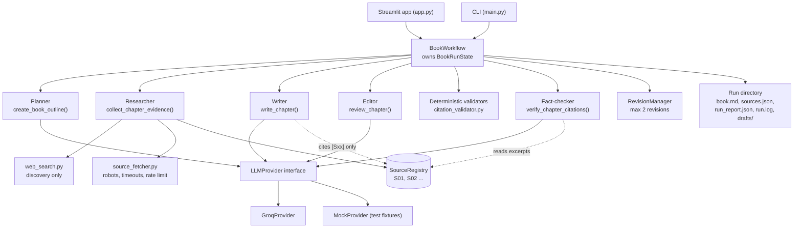
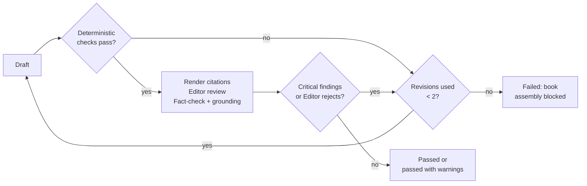

# INK & EVIDENCE — Design Notes

This document records the design decisions behind the application: how the workflow is
structured, what blocks publication, and which risks the design addresses.

## Design goals

| Goal | How it is met |
|---|---|
| Every factual claim traces to a retrieved page | Discovery (search results) and evidence (fetched page text) are separate types; the Writer cites registered IDs only |
| The model never writes a URL or reference | `[Sxx]` tokens are rendered into chapter-local `[n]` citations and a reference list built from the source registry |
| Failures are explicit | Inaccessible sources, quota errors and malformed output each have a distinct, recorded outcome |
| Demo output is never mistaken for research | Fixture sources use the `test_fixture` status and are labelled in the book, report and UI |
| Costs and retries are bounded | At most two revisions per chapter, bounded provider retries, per-request token budgets |

## Architecture

### Per-chapter control flow

### Why a plain Python workflow

The control flow is a loop over chapters with a bounded inner revision loop. Plain
Python expresses that directly, keeps the revision limit visible in one place and adds
no dependency. A graph framework would help with parallel branches, persisted
checkpoints or human-in-the-loop pauses, none of which the application needs.

## Publication policy

| Finding | Severity | Effect |
|---|---|---|
| Unknown citation ID, missing reference, inaccessible source cited | Critical | Revise; blocks publication if unresolved |
| Word count out of range, missing or misplaced `Takeaway:`, bullet or numbered list lines | Critical | Revise; blocks publication if unresolved |
| Number, date, percentage, amount or identifier in a sentence without a citation | Critical | Revise; blocks publication if unresolved |
| Cited percentage or decimal absent from the cited source's excerpts | Critical | Revise; blocks publication if unresolved |
| Fact-check verdict `unsupported` or `contradicted` | Critical | Revise; blocks publication if unresolved |
| Other cited figure absent from the cited excerpts; uncited speed claim without digits | Warning | Listed for human review |
| Fact-check verdict `uncertain` | Warning | Published only as "passed with warnings" |
| Editor style suggestions after approval | Info | Recorded in the report |

An Editor that still rejects a chapter after the revision limit, with no critical issues
outstanding, produces "passed with warnings": style is advisory. A Fact-checker that
returns no claims for a chapter that cites sources is a critical finding, because the
chapter has not actually been verified.

A blocked run saves `failure_report.md`, `sources.json`, `run_report.json`, `run.log` and
all drafts. It does not save `book.md`.

## Design decisions

| Decision | Reason |
|---|---|
| Deterministic checks run before the Editor and Fact-checker | A structurally broken draft must be rewritten anyway; skipping two model calls saves quota |
| Agents send an `input_payload` dict, not a rendered prompt | The Groq provider renders it into the prompt and the mock reads it directly, so the mock needs no prompt parsing |
| The Researcher is tool-driven, not model-driven | Excerpts are exact slices of page text, so evidence cannot be paraphrased or invented |
| Fact-check verdicts are re-checked in code (`ground_claim_verdicts`) | Invented excerpt IDs, evidence from uncited sources and figures missing from the excerpts are caught deterministically |
| Writer citations such as `[S02-E1]` are normalised to `[S02]` | Models sometimes cite the excerpt IDs shown in their input; only the token's form changes, never which source is cited |
| Revisions are minimal edits of quoted sentences | Preserves correct prose and citations and reduces token use |
| The completion budget is derived from the per-minute token limit | Groq counts prompt plus requested reply against that limit |
| Mock mode always uses fixture research | The offline demo never touches the network and never mixes fixture and real evidence |
| `NetworkBlockedError` is separate from authentication errors | A proxy 403 must not be reported as "Groq denied access" |
| Sources are labelled official or secondary by host | Readers can see how much of a chapter rests on primary sources |

## Risks and mitigations

| Risk | Mitigation |
|---|---|
| Hallucinated citations, URLs or statistics | Writer emits only `[Sxx]` tokens; references are rendered from the registry; figure checks compare cited figures with the excerpts |
| The language-model fact-checker misjudges support | Verdicts must cite excerpt IDs, code checks they belong to the cited source, `uncertain` is surfaced for humans, and reports never claim proof |
| Free search breaks or rate-limits | Replaceable `SearchAdapter`, bounded retries, clear failure state |
| Official sources block automated clients | Respect the restriction, record the page as inaccessible, try other results, label sources by tier |
| Provider quota exhaustion mid-run | Short waits retried; long waits and daily limits stop the run with a clear message; partial state and drafts are saved |
| Malformed or truncated structured output | Pydantic validation, one repair attempt, truncation detected and logged |
| Endless revision loop | Hard limit of two revisions, tested with an always-failing provider |
| Secret leakage | `SecretStr` config, redacting log formatter, no request bodies logged |
| Mock output mistaken for research | `test_fixture` status and labels in the book, report and UI |
| Misleading UI progress | Stage callbacks fired by the workflow itself; no percentages |
